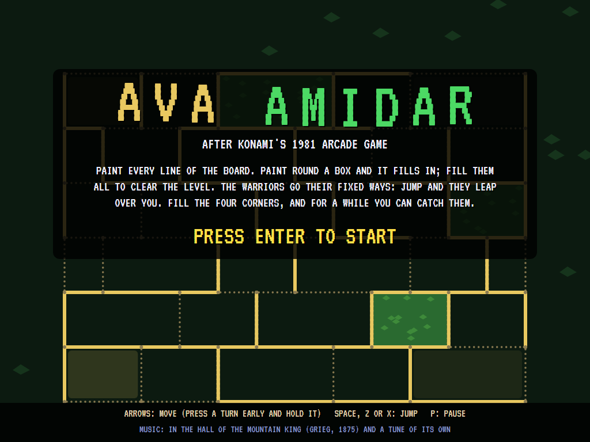
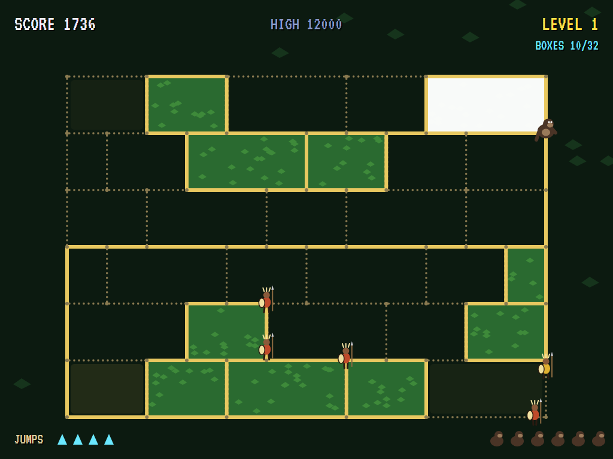
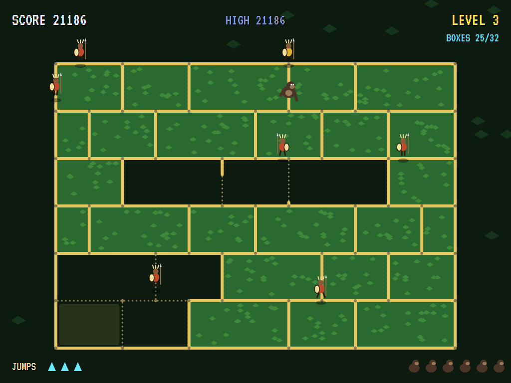
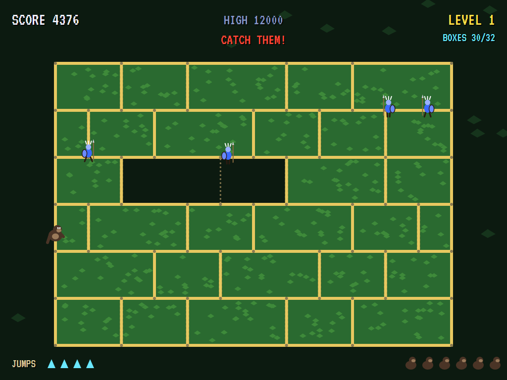
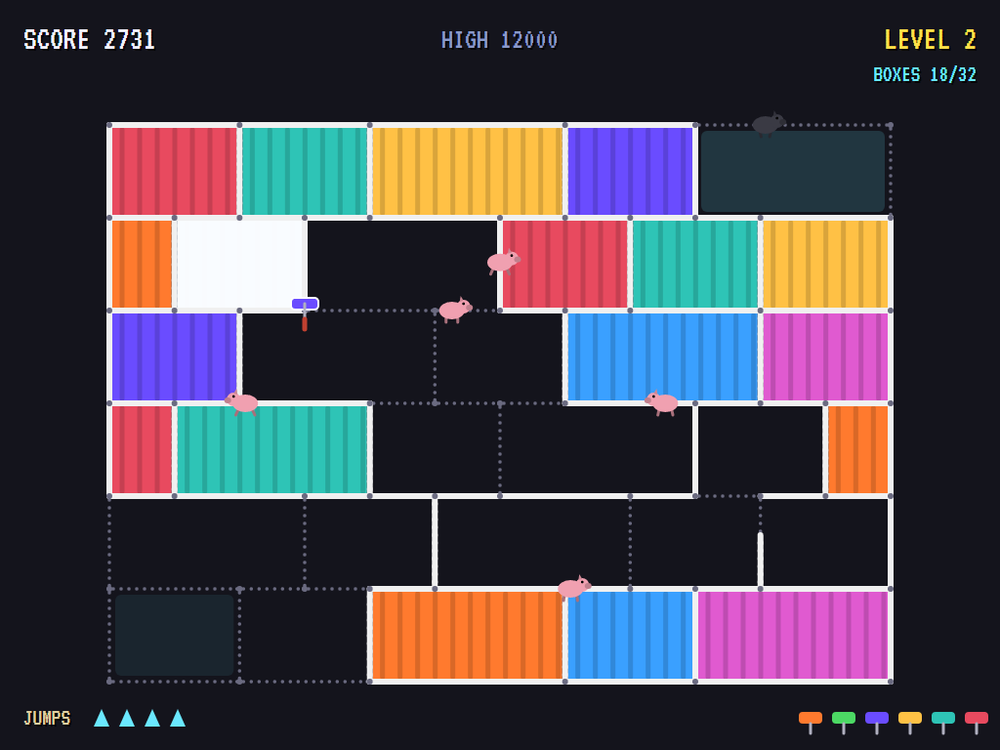
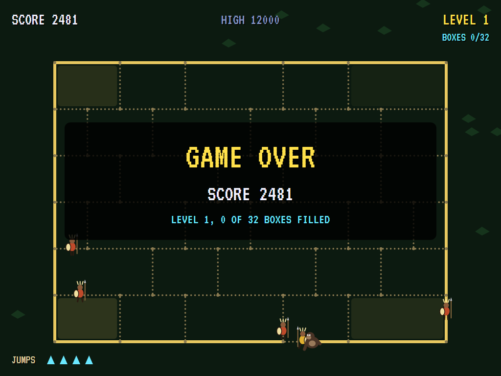
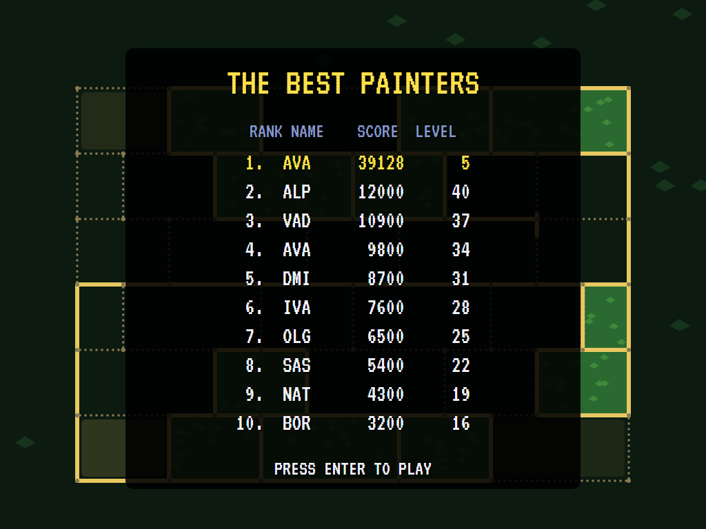

# AVA Amidar

[](https://github.com/Harlock123/AVAAmidar/actions/workflows/build.yml)

A maze game in the style of Konami's 1981 arcade game **Amidar**, built with .NET 10 and Avalonia UI. Paint every
line of the board. Paint all the way round a box and it fills in; fill every box to clear the level. The warriors
go their fixed ways across the board, and touching one costs a life. Jump, and they leap over you. Fill the four
corner boxes, and for a while you can catch them.

## Features

- **The board:** seven lines across, joined by uprights set differently in every row, making 32 boxes of all
  sizes. Unpainted lines are dotted; as you go along them they turn solid.
- **Two kinds of level, in turn.** On odd levels a gorilla paints the jungle, against spear-carrying warriors, and the
  boxes fill with leaves. On even levels a paint roller paints the shop, against pigs, and the boxes fill with
  colour.
- **The Amidar way:** each warrior goes along a line to the next meeting, then up or down to the next, then along
  again. So they cross the board in long staircases, turning back at its edges, the same way every time. The
  tracer, in gold (or black), goes round and round the outside.
- **Jumps:** four a level. Press jump and every warrior leaps into the air for a moment, and you can pass under
  them.
- **The corners:** fill all four corner boxes and the warriors turn blue for six and a half seconds. Catch them for
  200, 400, 800, then 1,600 each. They come back at the top when it's over.
- **More warriors each level**, quicker each level: four and the tracer at first, up to six and the tracer.
- **Scoring:** a point for every piece of line painted, 100 a box, 2,000 for a cleared level. Three lives, and
  another every 20,000.
- **The attract mode** shows the computer player at work. Before each meeting it tries every way it could go on
  a copy of the board: that way to the meeting, each way from there, then on toward the nearest line still to
  paint, keeping off lines the warriors are on, for two and a half seconds. The warriors' ways are fixed, so the copy
  shows exactly where they'll be. It takes the way that paints most without being caught, and jumps when every way
  is fatal.

## Screenshots

| The title | The jungle | A jump |
|:---------:|:----------:|:------:|
|  |  |  |
| | Ten boxes filled. | The warriors in the air. |

| The corners | The paint shop | Game over |
|:-----------:|:--------------:|:---------:|
|  |  |  |
| Catch them! | The roller and the pigs. | |

| The best painters |
|:-----------------:|
|  |

The screenshots are made by the tests, which play the game in a real (headless) window; see
[Tests](#tests).

## Download and run

Ready-to-run builds for Windows, macOS and Linux, on both Intel/AMD and ARM, are on the
[Releases page](https://github.com/Harlock123/AVAAmidar/releases/tag/latest). **Latest build** is
rebuilt on every push to `main`. Each download is one self-contained executable: no .NET install is
needed.

| Platform | Archive |
|---|---|
| Windows | `AVAAmidar-win-x64.zip`, `AVAAmidar-win-x86.zip`, `AVAAmidar-win-arm64.zip` |
| macOS | `AVAAmidar-osx-arm64.tar.gz` (Apple silicon), `AVAAmidar-osx-x64.tar.gz` (Intel) |
| Linux | `AVAAmidar-linux-x64.tar.gz`, `AVAAmidar-linux-arm64.tar.gz`, `AVAAmidar-linux-arm.tar.gz` |

```bash
tar -xzf AVAAmidar-linux-x64.tar.gz     # or linux-arm64, linux-arm, osx-arm64, osx-x64
./AVAAmidar
```

On Windows, unzip and run `AVAAmidar.exe`. On macOS, if Gatekeeper refuses to open it, run
`xattr -d com.apple.quarantine AVAAmidar` once. Run with `--no-audio` for silence.

**Sound** comes through OpenAL Soft, built in for every platform. In a virtual machine the game
detects it and uses a larger audio buffer, so the sound doesn't break up.

**Gamepads** use SDL2, which is bundled for Windows, macOS and Intel/AMD Linux. ARM Linux builds need it
installed; without it the keyboard still works:

```bash
sudo apt install libsdl2-dev            # Debian / Ubuntu / Raspberry Pi OS
sudo pacman -S --needed sdl2-compat     # Arch / Omarchy
```

## Controls

| Action | Keyboard | Gamepad |
|---|---|---|
| Start | Enter or 1 | Start |
| Move | Arrows or WASD. Press a turn before the meeting and hold it; the last arrow pressed counts | Left stick / D-pad |
| Jump | Space, Z, X or Ctrl | A or B |
| Pause | P or Esc | Start |
| Sound on/off | M | |
| Screenshot | Ctrl+S (to your Pictures folder) | |

On the high-score table, type your initials, or use up/down and Space, then Enter.

## Tests

```bash
dotnet test AVAAmidar.slnx
```

The game runs in fixed 60 Hz steps, so it plays the same at any frame rate. Everything that changes lives in
one world that can be copied. The tests check:

- **The board:** 32 boxes, four of them corners, every one closed, and every meeting reachable.
- **Painting:** a line painted as you go along it, and a box filled when the last line round it is painted.
- **Moving:** a turn held, taken at the next meeting; straight on otherwise; turning back between meetings;
  stopping in a corner.
- **The warriors:** the Amidar staircase, turning back at the edges; the tracer round the outside; a touch the
  end; a jump over; the four corners, and catching them; more of them, and quicker, each level.
- **Clearing a level**, and the next, the other kind.
- **The computer player** clearing the first two levels without being caught; wandering about getting caught.
- **The game:** lives, the extra one, the end and a high score; the demonstration and high scores; a copied
  world going on as the original; the keys.

`tests/AVAAmidar.Tests/PilotProbe.cs` reports how the computer player gets on, for tuning (`AMIDAR_PROBE=1`). It
clears four levels in twenty minutes without being caught once. `AMIDAR_PROBE=lazy` wanders about and is caught
twelve times in under three minutes.

The screenshot tests draw the real screen in a headless window. To refresh the README's pictures:

```bash
AMIDAR_SHOTS=$PWD/Images dotnet test tests/AVAAmidar.Tests --filter ScreenshotTests
```

## Building

```bash
dotnet build AVAAmidar.slnx
dotnet run --project src/AVAAmidar
```

Needs the .NET 10 SDK. The sounds, music and voice are made by `tools/make_sounds.py` (standard-library
Python, with the formant voice in `tools/speech.py`): `python3 tools/make_sounds.py` rewrites
`src/AVAAmidar/Sounds`.

## Project structure

```
AVAAmidar/
├── AVAAmidar.slnx
├── src/AVAAmidar/
│   ├── Engine/
│   │   ├── GameEngine.cs        # States, levels, lives, the demonstration
│   │   ├── Sim.cs               # Moving on the lines, painting and filling, the warriors' ways, jumps, the corners
│   │   ├── World.cs             # The board (meetings, lines, boxes), and everything that changes, kept so it can be copied
│   │   ├── Pilot.cs             # The computer player (the demonstration, and the tests)
│   │   ├── HighScoreTable.cs, InitialsEntry.cs
│   │   ├── InputHandler.cs, ControllerManager.cs  # Keys and an SDL2 gamepad
│   │   └── SoundManager.cs      # Effects, music and voice through OpenAL
│   ├── Audio/                   # The OpenAL engine (from the author's AVABand)
│   ├── Views/GameCanvas*.cs     # The board, the gorilla and the roller, the warriors and the pigs, the title
│   └── Sounds/                  # The synthesised effects, music and voice
├── tests/AVAAmidar.Tests/       # Gameplay and screenshot tests
├── tools/make_sounds.py, tools/speech.py
└── Images/                      # Screenshots
```

## About and licence

AVA Amidar © 2026 Lonnie Watson, under the [MIT License](LICENSE).

*Amidar* © 1981 Konami; the name *Amidar* belongs to its current owner. AVA Amidar is an independent, unofficial
game in its style. Its graphics, sounds and code are its own; nothing is taken from the original game's program,
graphics or sound. It is not affiliated with or endorsed by any rights holder. The title music is *In the Hall of
the Mountain King* by Edvard Grieg (1875); the tune in play is the game's own.
